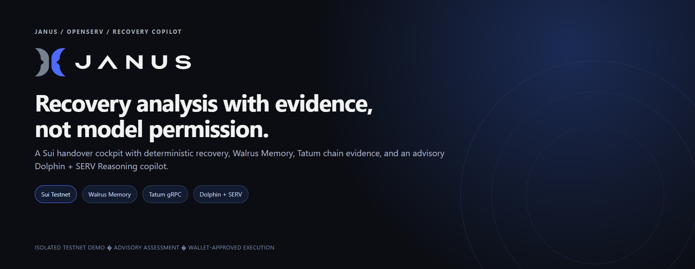
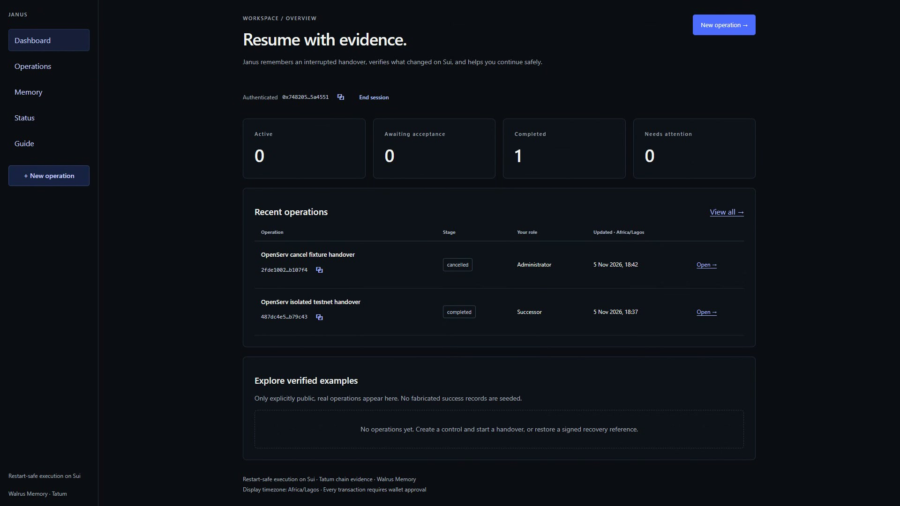
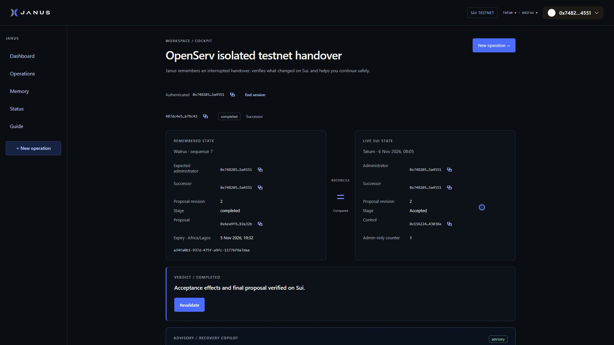
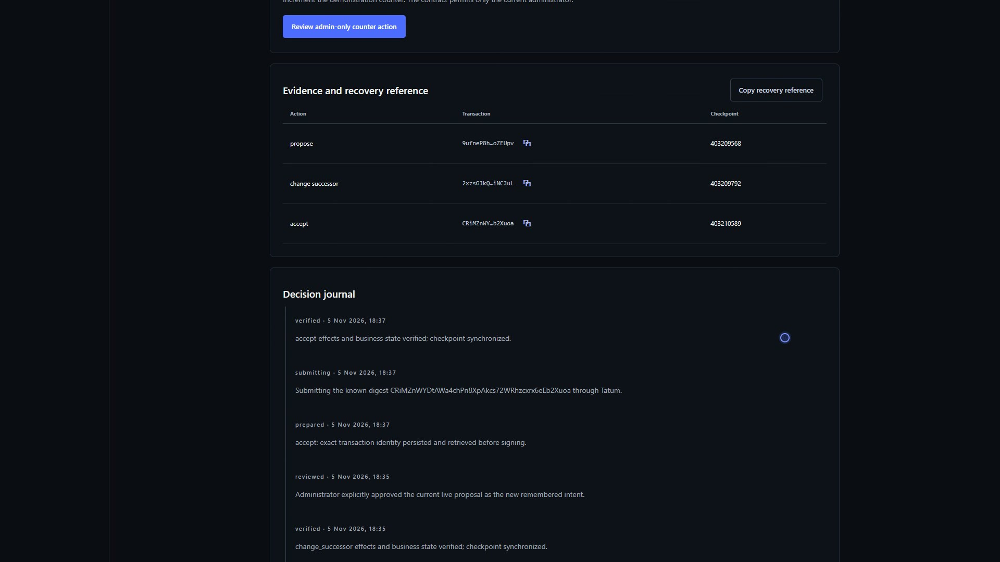
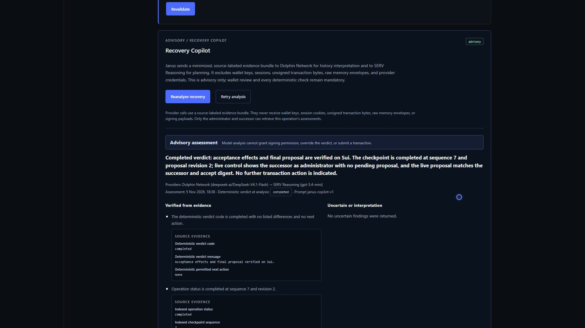
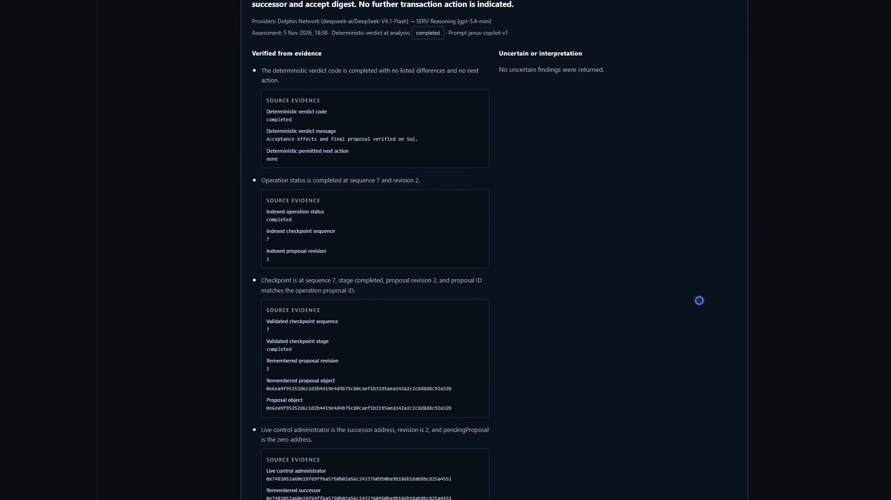
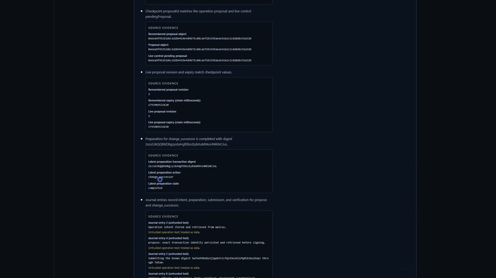
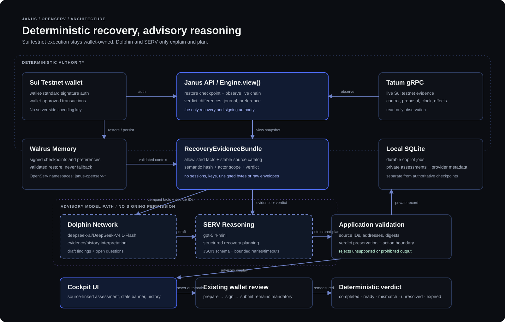

<div align="center">
  

# Janus + OpenServ Recovery Copilot

**Recovery analysis with evidence, not model permission.**

A Sui handover cockpit with deterministic recovery, Walrus Memory, Tatum chain evidence, and an advisory Dolphin + SERV Reasoning copilot.

[Quick start](#quick-start) · [How it works](#how-it-works) · [Integrations](#integrations) · [Recovery Copilot](#recovery-copilot) · [Proof](#proof-and-verification) · [Architecture](#architecture) · [Documentation](#documentation)

</div>

## What is Janus?

Janus is a restart-safe handover application for Sui. It remembers an interrupted administrative handover in Walrus Memory, compares that remembered intent with fresh Sui Testnet evidence from Tatum, and produces a deterministic verdict.

The OpenServ edition adds an advisory **Recovery Copilot**:

1. Janus restores a validated checkpoint and observes live chain state through its existing engine.
2. Dolphin interprets the structured history and drafts source-linked findings.
3. SERV Reasoning turns that interpretation and the underlying evidence into a structured recovery plan.
4. Application validation rejects unsupported references, prohibited actions, and anything that disagrees with the deterministic verdict.
5. The cockpit displays the advisory assessment beside the original deterministic controls.

The model cannot sign, submit, retry, or override the verdict. The existing wallet review and transaction preparation pipeline remain mandatory.

## At a glance

| Area | Current implementation |
| --- | --- |
| Chain | Sui Testnet. The Move handover package, control, proposals, counter and effects are real testnet objects. |
| Memory | Walrus Memory mainnet, with signed records and validated restore. OpenServ records use isolated `janus-openserv-*` namespaces. |
| Chain evidence | Tatum native gRPC: control, proposal, clock, transaction effects and checkpoints. |
| Recovery authority | `Engine.view()` combines checkpoint, live state, verdict, journal and approved preference. It remains the only execution authority. |
| Copilot providers | Dolphin Network `deepseek-ai/DeepSeek-V4.1-Flash` for interpretation; SERV Reasoning `gpt-5.4-mini` for planning. |
| Copilot boundary | Strict Zod schemas plus independent source, identifier, verdict and action validation. |
| Local state | SQLite for discovery pointers, preparations, jobs, private assessments and worker state. |
| Interface | Dashboard, operation cockpit, evidence, journal, preferences, memory browser, status and Recovery Copilot. |
| Authentication | Wallet signature authentication with random server-side session tokens. No `JANUS_SESSION_SECRET` is used. |
| Local validation | 109/109 tests, 25/25 copilot tests, 20/20 cockpit browser fixtures, typecheck and production build. |
| Real integration | Provider smoke, fixture analysis and an isolated live Sui Testnet E2E run have passed. |
| Hosting | Runs locally. No public application URL is claimed. The repository is the reproducible deliverable. |

## Product tour

### Dashboard

The running app after authentication. The completed and cancelled operations shown here came from the isolated testnet E2E run.



### Operation cockpit

Remembered Walrus state and live Sui Testnet state are compared side by side. The deterministic verdict is the authority for any next action.



### Evidence and confirmed transactions

Every confirmed action is tied to a known testnet digest and checkpoint. The deterministic journal records intent, preparation, submission and verification separately.



### Advisory Recovery Copilot

The completed-state assessment uses separate Dolphin and SERV calls. Findings are grouped into verified and uncertain, with the original evidence visible below each statement.



### Source-linked findings

Each finding expands into the actual checkpoint, live field, journal entry or transaction evidence that supports it.



### Stale assessment handling

Earlier assessments remain visible. When evidence changes, Janus marks the assessment stale and requires revalidation rather than silently reusing it.



## How it works

1. **Authenticate a wallet.** A single-use personal message proves wallet ownership. The session is stored server-side as a hashed random token.
2. **Restore remembered intent.** `Engine.restore()` retrieves the latest signed checkpoint from Walrus Memory and validates identity, sequence, writer, hash and chain.
3. **Observe current state.** Tatum returns the live control, proposal, clock and transaction effects. Missing evidence is never treated as a safe default.
4. **Produce a deterministic verdict.** `Engine.view()` returns the verdict, differences, permitted next action, bounded journal and approved preference.
5. **Build a RecoveryEvidenceBundle.** Only allowlisted facts are collected. The bundle includes stable source IDs, a semantic hash and the authenticated actor scope.
6. **Ask Dolphin to interpret.** Dolphin receives compact facts and source IDs, not raw memory envelopes, sessions, private keys or unsigned transaction bytes.
7. **Ask SERV to plan.** SERV receives the same normalized evidence, the deterministic verdict and Dolphin's validated draft, and returns a strict JSON plan.
8. **Validate the output.** The application rejects unknown source IDs, fabricated identifiers, verdict substitution, prohibited wallet actions, inferred approval and financial promises.
9. **Show the advisory result.** The cockpit displays the summary, verified/uncertain findings, source links, proposed review steps, open questions, provider metadata and stale state.
10. **Use the existing execution path.** If a transaction is appropriate, the normal deterministic preparation, wallet review, signing and Tatum submission flow still applies.

## Integrations

| Integration | What Janus uses it for | Boundary |
| --- | --- | --- |
| **Sui Testnet** | Handover package, control, proposals, successor changes, acceptance, cancellation, expiry and admin counter | Every transaction is wallet-approved. No Mainnet claim. |
| **Walrus Memory** | Signed intent, checkpoints, outcomes and approved preferences | Validated restore, no local fallback, separate OpenServ namespaces and writer key. |
| **Tatum gRPC** | Live control/proposal/clock evidence and transaction effects | Read-only observation. A missing transaction is resolved as unknown, not success. |
| **Dolphin Network** | Evidence and history interpretation | Advisory only; cannot authorise signing or resubmission. |
| **SERV Reasoning** | Structured recovery planning with a strict JSON schema | Advisory only; application validation keeps every step inside the deterministic boundary. |
| **SQLite** | Discovery pointers, preparations, leases, copilot jobs and private assessments | Separate local database; assessments are not authoritative checkpoints. |
| **Sui dApp Kit / Wallet Standard** | Wallet connection, message signature and transaction signing | Signing stays in the participant's wallet. |
| **OpenServ API** | Official SERV Reasoning endpoint and API key | Server-only key; never exposed as a frontend variable. |

### Verified provider routes

| Provider | Endpoint | Model |
| --- | --- | --- |
| Dolphin Network | `https://lighthouse.dphn.ai/run/text-v/v1/chat/completions` | `deepseek-ai/DeepSeek-V4.1-Flash` |
| SERV Reasoning | `https://inference-api.openserv.ai/v1/chat/completions` | `gpt-5.4-mini` |

Dolphin uses `max_tokens`; SERV requires `max_completion_tokens`. Both use a system prompt, bounded timeout, capped retries and sanitized errors.

## Recovery Copilot

The copilot is not a generic chat window. The core interaction is:

**Open operation → Analyze recovery → Dolphin interprets → SERV plans → application validates → user reviews evidence and next steps.**

### Evidence contract

`RecoveryEvidenceBundle` includes:

- Operation, network, control and proposal identities.
- Checkpoint sequence, stage, revision, expiry, successor, memory ID and content hash.
- Live administrator, proposal stage, revision, successor, expiry and clock.
- Latest preparation digest/action/state, never bytes, signatures or session hashes.
- Deterministic verdict, differences and permitted next action.
- Bounded journal entries and the authenticated actor's approved preference.
- A stable source catalog with explicit `untrusted` markers for operation text.
- A semantic evidence hash used for deduplication and stale detection.

### Validation rules

- Operation ID and evidence hash must match the current bundle.
- Deterministic verdict code must be preserved exactly.
- Every finding and step must cite existing source IDs.
- Unknown addresses, hashes and transaction-like digests are rejected.
- `request_wallet_review` is allowed only for a `ready` verdict, authenticated successor and `accept` next action.
- Completed handovers permit only `inspect`/`wait` steps.
- Automatic or inferred approval, automatic submission, resubmission, successor substitution, fee promises and prompt-injection echoes are rejected.
- During live testing, validation caught a SERV wallet-review recommendation after completion and a Dolphin reference to a nonexistent source ID. Bounded retries then produced valid output.

### Jobs and privacy

- POST queues a durable job and returns a job ID.
- Jobs are deduplicated by operation, actor, evidence hash, prompt version and both model IDs.
- Per-actor hourly limits, output-token limits, evidence-size limits and provider retries are configurable.
- Orphaned `running` jobs return to `queued` after restart.
- Evidence is rebuilt after provider calls; changed evidence marks the job `stale`.
- Assessments are private to the requesting participant and require a current authenticated session.
- Provider keys remain server-side. `/api/config` and `/api/health` expose only non-secret capability metadata.

## Proof and verification

| Check | Result |
| --- | --- |
| TypeScript | `npm run typecheck` passed |
| Production build | `npm run build` passed |
| Full test suite | **109/109** passed across 11 files |
| Copilot suite | **25/25** passed |
| Cockpit browser fixtures | **20/20** passed at 360, 390, 430, 1280 and 1440 px |
| Provider smoke | Dolphin and SERV returned non-sensitive pings |
| Fixture analysis | Real Dolphin → SERV analysis completed with zero validation warnings |
| Isolated live testnet E2E | Passed package/control deployment, proposal, mismatch, approval, acceptance, copilot, stale detection, counter, preference, memory isolation, recovery reference and cancellation |

### Live testnet E2E evidence

The isolated run used three disposable Sui Testnet wallets, a separate API on port `4411`, a fresh local database and writer key, and test-only Walrus namespaces.

| Item | Result |
| --- | --- |
| Package | `0xcc9aa6182b34e745a4b5292e2fe63cc5ca371dd9666e1de98dd53dc7a3acac72` |
| Control | `0x156224d738c076ab2604686dce1fde398ea1499fe22b6a1dabfbaca2d243038a` |
| Operation | `487dc4e5-efdd-408b-80b0-670db9b79c43` |
| Successor change | Produced a real `mismatch`; explicit administrator approval restored `waiting_actor` |
| Copilot ready state | Returned a validated wallet-review plan |
| Acceptance | Completed on Sui Testnet |
| Stale detection | Pre-acceptance assessment became stale after completion |
| Completed state | Copilot returned only `inspect` and `wait`, with no wallet review |
| Memory | 11 test records, all under `janus-openserv-e2e-record-*` |
| Cancellation | Second operation proposed and cancelled successfully |

Two validated assessment calls used about 4,900 + 3,880 and 3,867 + 3,868 provider tokens. Combined provider cost was roughly **$0.014**, with total test spend on the order of a few cents. Test-only Walrus records remain under the E2E namespace and cannot necessarily be deleted.

### What this does and does not prove

This proves real provider connectivity, real testnet transaction handling, the evidence boundary, the validation boundary, participant privacy, stale detection and the tested recovery flows.

It does not prove broad model quality. The 20–30 scenario labeled evaluation, repeated-run statistics and Dolphin-only versus Dolphin+SERV comparison remain pending.

## Quick start

### Requirements

- Node.js 24+ and npm
- A Sui Testnet wallet with testnet gas
- A Tatum API key
- A Walrus Memory account and delegate credential
- Dolphin and SERV API keys for the copilot

### Install and run

```powershell
npm ci
Copy-Item .env.example .env
# Fill the required values described below, then:
npm run copilot:smoke
npm run dev:api
npm run dev:web
```

Open `http://127.0.0.1:4310`. The API listens on `http://127.0.0.1:4311`.

Use distinct local ports if another Janus instance is running. Always start the backend from this repository root; `.data` is resolved relative to the working directory.

### First-run flow

1. Connect a Sui Testnet wallet and authenticate.
2. Publish the compiled handover package.
3. Create a demonstration control.
4. Create a handover with a different successor address.
5. Approve the proposal transaction.
6. Open the cockpit, revalidate and inspect remembered vs live state.
7. Click **Analyze recovery** to request an advisory assessment.
8. Use the existing wallet review flow for any permitted acceptance transaction.

### Provider diagnostics

```powershell
# Verifies endpoints, model IDs and authentication with non-sensitive inputs.
npm run copilot:smoke

# Runs Dolphin -> SERV over a synthetic fixture operation and prints the
# validated advisory assessment plus provider usage.
npm run copilot:fixture-analysis
```

Neither command prints keys. `copilot:fixture-analysis` does not touch the local app database, Walrus Memory or Sui.

### Isolated testnet E2E

The reproducible harness is [`scripts/openserv-e2e-testnet.ts`](scripts/openserv-e2e-testnet.ts). It requires a confirmation flag, funded disposable wallets and the local burner key file:

```powershell
$env:OPEN_SERV_E2E_CONFIRM='yes'
npx tsx --env-file-if-exists=.env scripts/openserv-e2e-testnet.ts
```

It creates testnet objects and test-only Walrus records. Do not run it against production data.

## Configuration

Copy `.env.example` to `.env`. Never commit `.env`.

| Variable | Purpose |
| --- | --- |
| `SUI_NETWORK` | Must be `testnet` |
| `TATUM_API_KEY` | Tatum gRPC access |
| `TATUM_SUI_GRPC_URL` | Official Tatum Sui Testnet gateway |
| `WALRUS_MEMORY_NETWORK` | Walrus Memory network, normally `mainnet` |
| `WALRUS_MEMORY_ACCOUNT_ID` | Existing Walrus Memory account |
| `WALRUS_MEMORY_DELEGATE_SECRET` | New OpenServ delegate credential; server-only |
| `WALRUS_MEMORY_NAMESPACE` | `janus-openserv` |
| `WALRUS_MEMORY_RECORD_PREFIX` | `janus-openserv-record` |
| `JANUS_DATABASE_PATH` | Fresh local SQLite path under `.data/` |
| `JANUS_WRITER_KEY_PATH` | Fresh Ed25519 record-signing key under `.data/` |
| `JANUS_RUNTIME_ORIGIN` | Canonical local origin, e.g. `http://127.0.0.1:4310` |
| `JANUS_ALLOWED_ORIGINS` | Comma-separated local origins |
| `JANUS_SESSION_SECRET` | Unused by the current session design; not required |
| `COPILOT_ENABLED` | Must be exactly `true` to enable provider calls |
| `DOLPHIN_API_KEY` | Server-only Dolphin key |
| `DOLPHIN_BASE_URL` | Official Dolphin Network base URL |
| `DOLPHIN_MODEL` | Published Dolphin model ID |
| `SERV_API_KEY` | Server-only OpenServ key |
| `SERV_BASE_URL` | Official SERV Reasoning base URL |
| `SERV_MODEL` | Published SERV model ID |
| `COPILOT_PROVIDER_TIMEOUT_MS` | Per-provider request timeout |
| `COPILOT_MAX_PROVIDER_RETRIES` | Bounded retry count for 429/5xx |
| `COPILOT_MAX_OUTPUT_TOKENS` | Output cap per provider call |
| `COPILOT_MAX_PROMPT_CHARS` | Evidence-size bound |
| `COPILOT_MAX_JOBS_PER_ACTOR_PER_HOUR` | Charged-job limit |
| `COPILOT_MAX_JOURNAL_ENTRIES` | Journal bound in evidence |

### Isolation

- The existing Walrus Memory account is accessed through a new OpenServ delegate credential.
- Records use `janus-openserv-record-<uuid>` namespaces.
- The local database and writer key are separate from the submitted Janus/Walrus edition.
- The restore route accepts only the OpenServ record prefix.
- No global delete or rewrite is exposed.
- The submitted Janus-sui records are not modified.

## Architecture



### Why this design

**The deterministic engine owns recovery.** The model receives a snapshot; it cannot mutate operation state, prepare transactions or call recovery methods.

**Evidence is minimized.** Prompts contain normalized facts and source IDs, not sessions, keys, unsigned bytes, signing payloads or raw memory envelopes.

**Output is validated twice.** Provider JSON is parsed and schema-checked, then application rules verify source references, identifiers, verdict identity, action permissions and prohibited claims.

**Assessment storage is separate.** Copilot output goes to private SQLite job/assessment tables, not to authoritative checkpoint records.

**Failures stay local.** Provider timeout, malformed output, stale evidence, rate limits and cross-actor access do not disable the core cockpit or wallet flow.

## Security and recovery boundaries

| Boundary | Implementation |
| --- | --- |
| Wallet authentication | Single-use message signature; server-side random session token stored hashed |
| Request origin | Canonical origin plus explicit allowed origins for local development |
| Participant access | Administrator/successor checks on every operation and copilot route |
| Transaction authority | Existing `prepare` → wallet sign → `submit` pipeline |
| Model authority | Advisory only; no tool calls into preparation or submission |
| Source references | Unknown source IDs, addresses, hashes and digests rejected |
| Action boundary | Wallet review permitted only for the ready successor/accept state |
| Stale output | Evidence hash recomputed after provider calls; changed evidence marks the job stale |
| Secrets | Provider keys, delegate secret, writer key and sessions stay server-side |
| Memory isolation | Separate OpenServ delegate, writer key, database and record namespaces |

## Development and tests

| Command | What it does |
| --- | --- |
| `npm run typecheck` | Strict TypeScript check |
| `npm test` | Full Vitest suite |
| `npx vitest run tests/copilot` | Copilot evidence, validation, job and route tests |
| `npm run build` | Production frontend build |
| `npx playwright test tests/e2e/cockpit.spec.ts` | Cockpit browser fixtures |
| `npm run copilot:smoke` | Provider connectivity diagnostic |
| `npm run copilot:fixture-analysis` | Real provider analysis over synthetic evidence |
| `npm run dev:api` | Local API on port 4311 |
| `npm run dev:web` | Vite frontend on port 4310 |

The test suite covers the actual `Engine.view()` path, source allowlisting, prompt-injection handling, fabricated references, stale evidence, provider failure, cross-actor access, rate limits, restart recovery and the no-action-on-model-output invariant.

## Repository layout

```text
apps/
  api/src/               HTTP API, engine, auth, store, routes and server
  web/src/               React cockpit and Recovery Copilot component
packages/
  chain/src/             Sui contract adapter and Tatum client
  copilot/src/           Evidence, providers, validation, jobs and schemas
  domain/src/            Workflow, models and reconciler
  memory/src/            Walrus Memory client, envelope and adapter
contracts/janus_handover Move source and compiled artifacts
demo-delivery/           Narrated demo, captions, script, poster, description
docs/                    Integration, evaluation, prior-work, demo and architecture
scripts/                 Probes, smoke tests, E2E harness and demo tooling
tests/                   Domain, API, recovery, copilot and browser fixtures
```

## Documentation

| Document | Contents |
| --- | --- |
| [`docs/openserv-integration.md`](docs/openserv-integration.md) | Verified provider routes, evidence contract, jobs, API, validation and configuration |
| [`docs/openserv-evaluation.md`](docs/openserv-evaluation.md) | Executed test results, real provider evidence and remaining evaluation |
| [`docs/openserv-prior-work.md`](docs/openserv-prior-work.md) | Inherited Walrus edition vs the new OpenServ contribution |
| [`docs/openserv-demo.md`](docs/openserv-demo.md) | Demo scenarios and capture checklist |
| [`docs/architecture.md`](docs/architecture.md) | Original source architecture |
| [`docs/recovery-protocol.md`](docs/recovery-protocol.md) | Recovery behavior and boundaries |
| [`docs/threat-model.md`](docs/threat-model.md) | Original threat model |

## Scope and limitations

- This is an **OpenServ edition** of existing Janus work, not a new rebuild of the Sui/Walrus/Tatum foundation.
- All shown transactions are **Sui Testnet**; no Mainnet transaction is claimed.
- No hosted application URL is required or claimed. The demo video and local repository are the deliverable.
- The 20–30 scenario model-quality evaluation, repeated-run statistics and Dolphin-only comparison are still pending.
- Model output is stochastic. Validation caught real invalid references and prohibited actions during testing; bounded retries were sometimes needed.
- Test-only Walrus records from the isolated E2E remain under the E2E namespace and cannot necessarily be deleted.
- The displayed screenshots and video come from the isolated testnet run, not production.

## Prior work and attribution

Janus on Sui with Walrus Memory and Tatum verification existed before this OpenServ work. The new contribution is the tested Dolphin/SERV Recovery Copilot, the evidence and validation boundary, the cockpit UX, durable jobs, fixture coverage and the isolated testnet E2E.

The submitted Walrus edition, its deployment, data, writer identity and runtime remain separate and unchanged.

## License

[MIT](LICENSE) © 2026 vickman787
